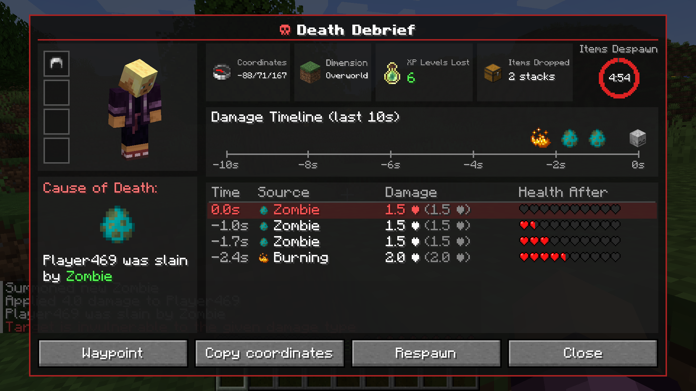
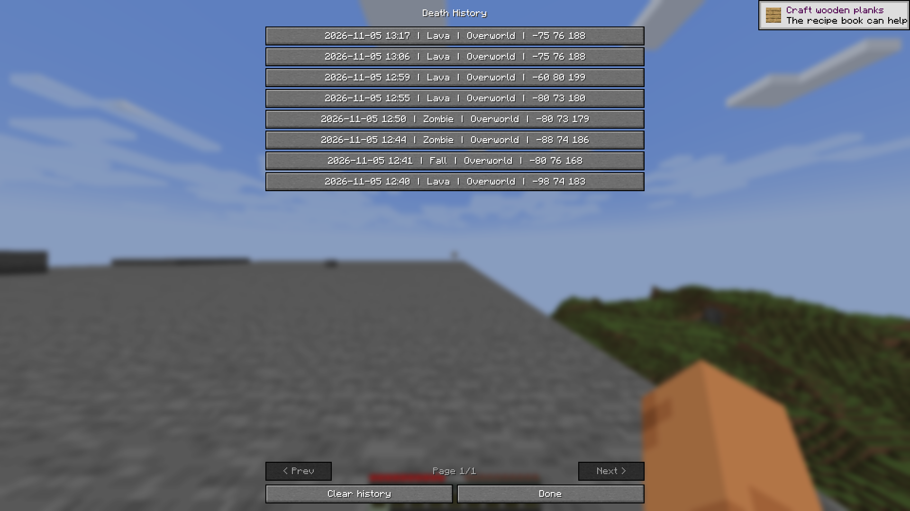
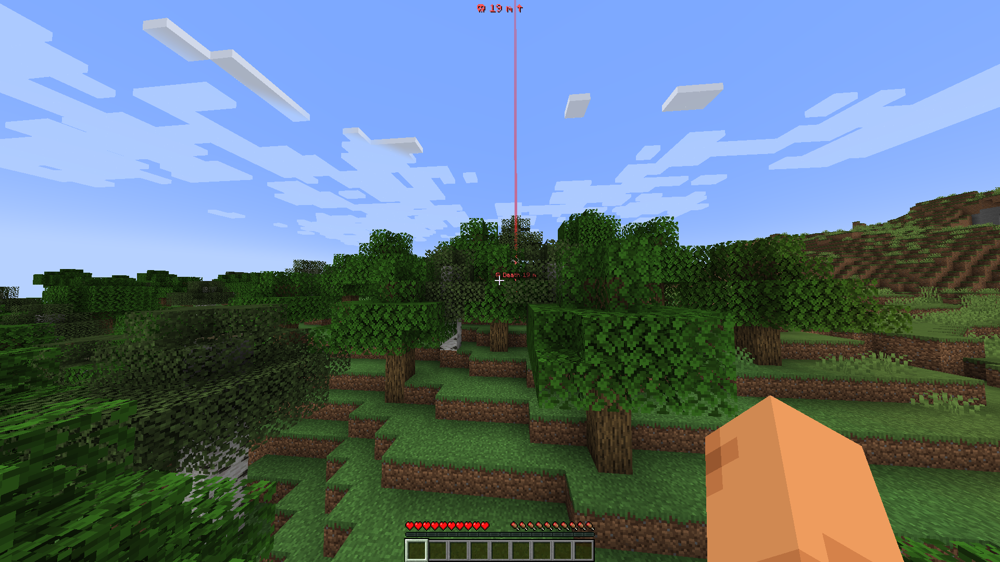
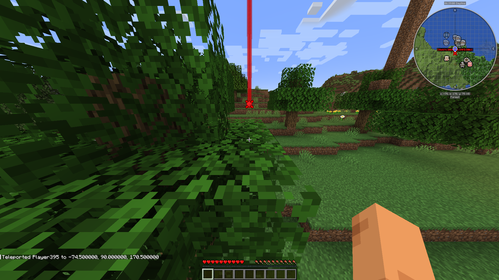

# Death Debrief

**Know exactly what killed you.** A detailed death report for Minecraft 1.21.1 on Fabric and NeoForge.



## Features
- Cause-of-death card with the real death message, player figure and armor at death
- Badges: coordinates, dimension, XP levels lost, item stacks dropped
- Circular item-despawn countdown (hidden with no items / keepInventory)
- Damage timeline of the last 10 seconds with icons
- Hit table: time, source, damage after/before armor, hearts left
- Buttons: Waypoint, Copy coords, Respawn, History, Close
- Death history: last 50 deaths per world/server saved to disk; browse with < > or the History list; old deaths show "Expired"
- Death waypoint: red beam, floating "☠ Death N m" label, HUD distance/arrow; automatic on death, clears on arrival or after 5 minutes
- JourneyMap integration (automatic waypoint) and Xaero's Minimap (one-click prefilled dialog)
- English and Russian

## Screenshots




## Usage
| Action | How |
|---|---|
| Open debrief | Key **B**, death-screen button, `/deathdebrief` |
| History | `/deathdebrief history` |
| Clear waypoint | `/deathdebrief waypoint clear` |

Config: `config/deathdebrief/client.json` (`historySize`, `autoWaypoint`, `builtinWaypoint`).

## Install
1. Install Fabric Loader + **Fabric API** (Fabric) or NeoForge for Minecraft 1.21.1.
2. Drop the mod jar into `mods/`.
3. For multiplayer, install it on the **server too** (the server sends the report). Singleplayer works out of the box.

## Build
**Fabric** (this folder):
```
gradlew build
```
The jar is in `build/libs/`.

**NeoForge** (`../deathdebrief-neoforge`):
```
cd ../deathdebrief-neoforge
gradlew build
```

## License
MIT. Author: fr4me.