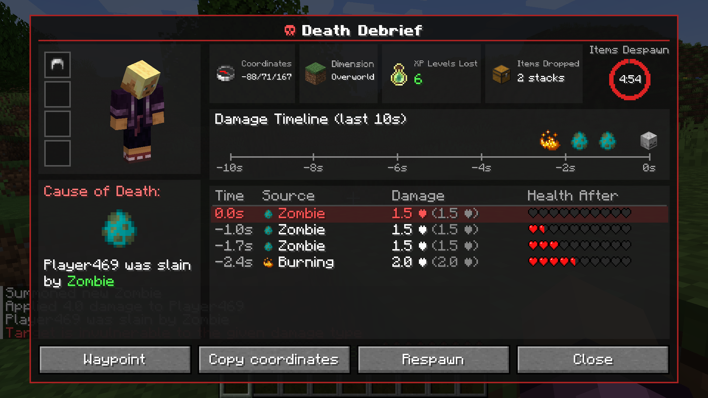
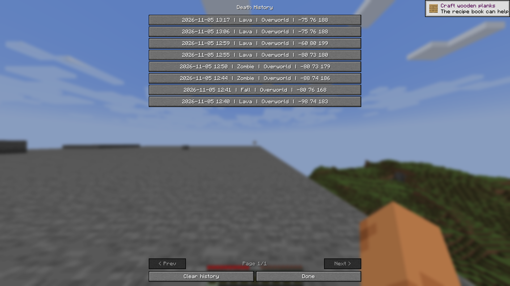
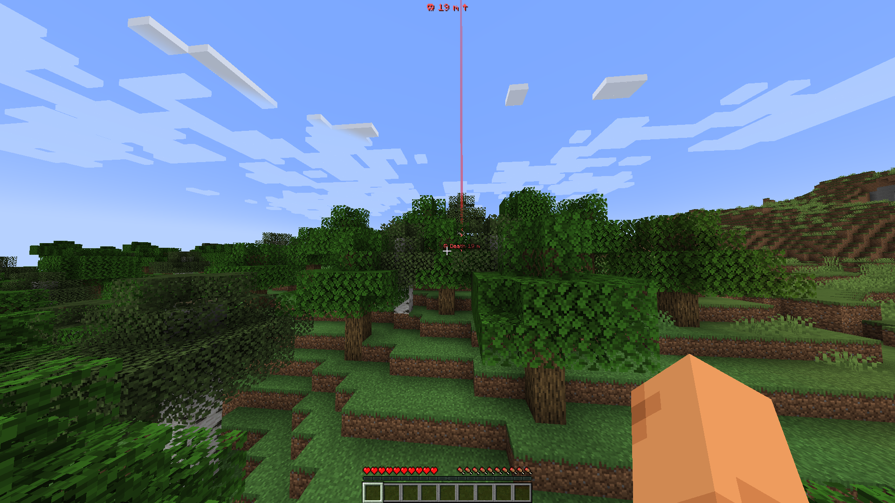
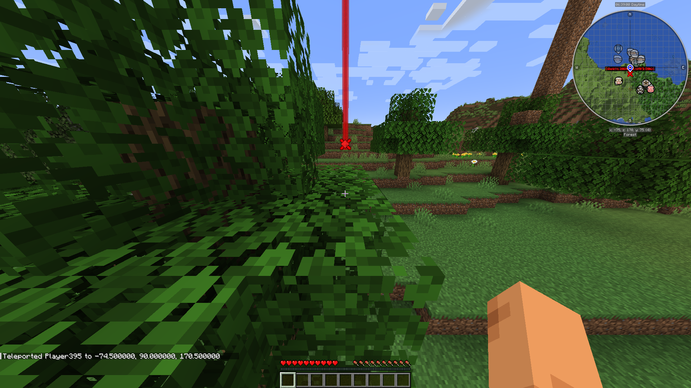

# Death Debrief

### Know exactly what killed you.

You died. Again. But *what* actually happened? Was it the creeper, the fall, or that one skeleton you never saw? **Death Debrief** shows a clear, detailed report the moment you die: the real death message, a timeline of every hit from the last 10 seconds, damage before and after armor, and where your items are.

## Features

### The debrief screen
- **Cause-of-death card** with the real death message
- **Player figure and armor** exactly as you were at the moment of death
- **Badges**: coordinates, dimension, XP levels lost, item stacks dropped (or "No items")
- **Circular item-despawn countdown**, hidden when you have no items or keepInventory is on
- **Damage timeline** of the last 10 seconds, with icons per damage type
- **Hit table**: time, source, damage after / before armor, hearts left
- **Buttons**: Waypoint, Copy coords, Respawn, History, Close
- Open it from the **button on the death screen**, with key **B**, or with `/deathdebrief`

### Death history
- Saves your **last 50 deaths per world / server** to disk
- Browse with **< >** or open the **History** list
- Deaths whose items have already despawned are marked **Expired**

### Death waypoint
- Built-in **red beam** and floating **"☠ Death N m"** label in the world
- **HUD distance and direction arrow**
- Set automatically on death; clears when you reach it or after 5 minutes
- Clear manually with `/deathdebrief waypoint clear`

### Minimap integration
- **JourneyMap**: a death waypoint is added automatically
- **Xaero's Minimap**: one click on the chat link opens Xaero's waypoint dialog, prefilled

### Languages
English and Russian.

## Commands and keybinds

| Action | How |
|---|---|
| Open the debrief | Key **B** (rebindable), death-screen button, or `/deathdebrief` |
| Death history list | `/deathdebrief history` |
| Clear death waypoint | `/deathdebrief waypoint clear` |

## Compatibility

| Mod | Support |
|---|---|
| Fabric API | Required (Fabric version) |
| JourneyMap | Automatic death waypoints |
| Xaero's Minimap | One-click prefilled waypoint dialog |
| Mod Menu | Supported (Fabric) |

- Minecraft **1.21.1**, loaders: **Fabric** and **NeoForge**

## Multiplayer

Install Death Debrief on **both the server and the client**: the server sends the death report. In singleplayer it just works.

## Configuration

`config/deathdebrief/client.json`

| Key | Description |
|---|---|
| `historySize` | How many deaths to keep per world/server (default 50) |
| `autoWaypoint` | Create the death waypoint automatically (default true) |
| `builtinWaypoint` | Built-in beam/HUD marker: `auto` (only without a minimap mod), `always` or `never` |

## FAQ

**Does it work on servers?** Yes, if the mod is installed on the server too.

**Can I turn off the automatic waypoint?** Yes, set `autoWaypoint` to `false`.

**I use JourneyMap / Xaero's. Will I see two markers?** By default (`auto`) the built-in marker is only shown when no minimap mod is installed.

**Where is my history stored?** On disk, per world or server, up to `historySize` deaths.

**Can I change the key?** Yes, in Controls under "Death Debrief".

## License

MIT. Made by **fr4me**.