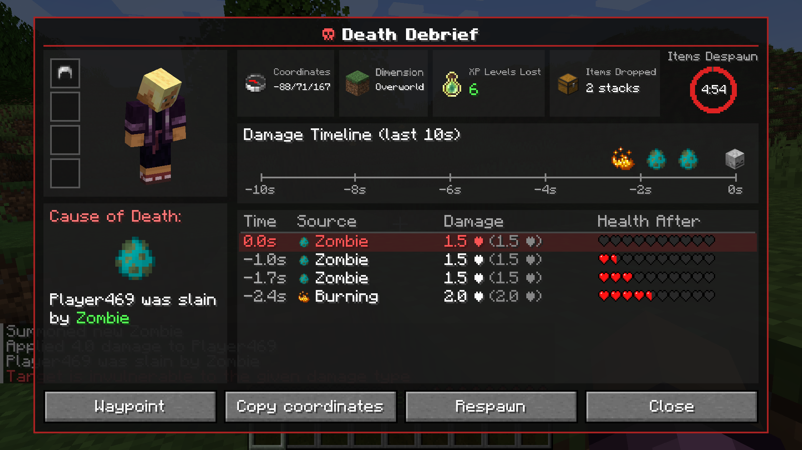
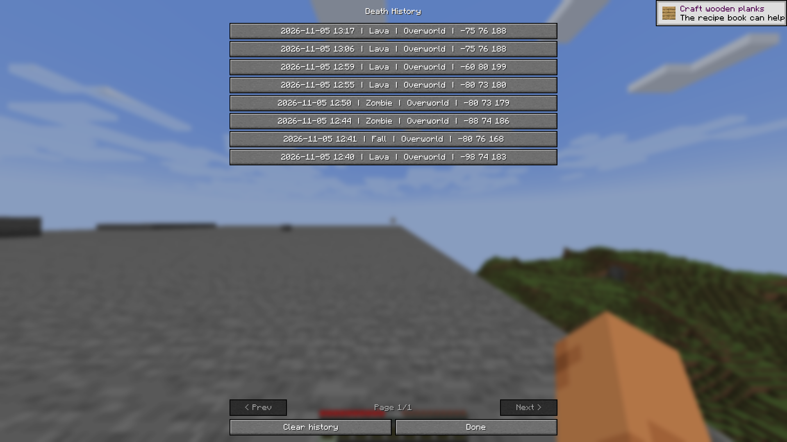
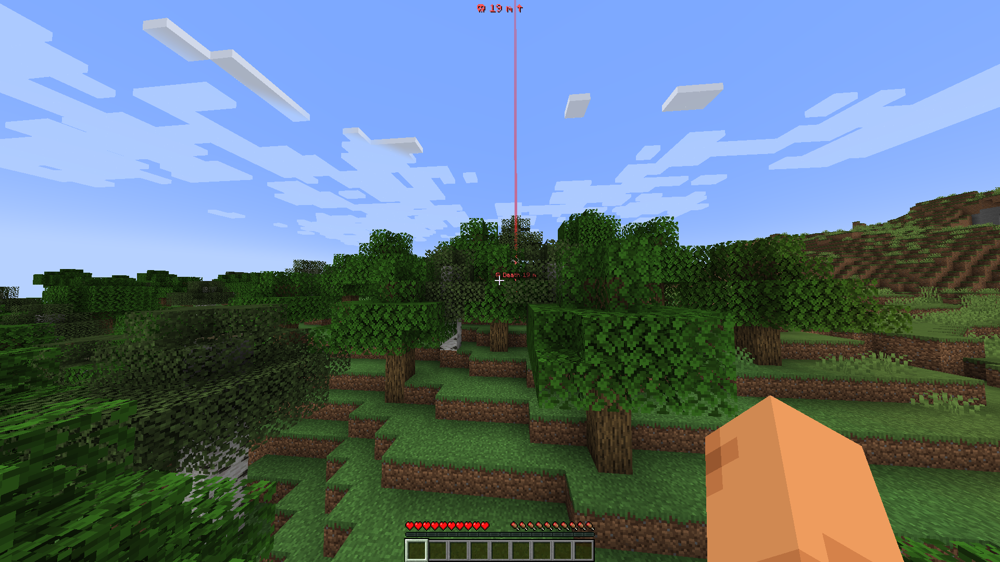
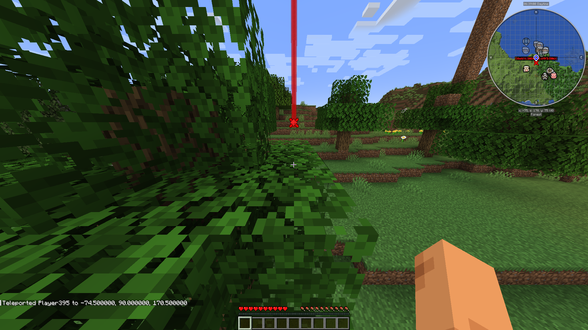

# Death Debrief

**Know exactly what killed you.** A detailed report the moment you die: real death message, last 10 seconds of damage, armor reduction, and your items' despawn timer.

## Features
- Cause-of-death card, player figure and armor at death
- Badges: coordinates, dimension, XP levels lost, item stacks dropped
- Circular item-despawn countdown (hidden with no items / keepInventory)
- Damage timeline (last 10 s) and hit table: time, source, damage after/before armor, hearts left
- Buttons: Waypoint, Copy coords, Respawn, History, Close
- Death history: last 50 deaths per world/server, browse with < >; old deaths show "Expired"
- Death waypoint: red beam, floating "☠ Death N m" label, HUD distance/arrow; auto on death, clears on arrival or after 5 min
- JourneyMap (automatic waypoint) and Xaero's Minimap (one-click prefilled dialog)
- English and Russian

## Commands and keybinds
| Action | How |
|---|---|
| Open debrief | Key **B**, death-screen button, `/deathdebrief` |
| History | `/deathdebrief history` |
| Clear waypoint | `/deathdebrief waypoint clear` |

## Compatibility
Minecraft 1.21.1, **Fabric** (needs Fabric API) and **NeoForge**. Works with JourneyMap, Xaero's Minimap and Mod Menu.

## Multiplayer
Install on both server and client (the server sends the report). Singleplayer just works.

## Config
`config/deathdebrief/client.json`: `historySize`, `autoWaypoint`, `builtinWaypoint`.

## FAQ
**Two markers with a minimap mod?** No, by default the built-in marker only shows without one.
**Disable the auto waypoint?** Set `autoWaypoint` to `false`.

MIT licensed. Made by fr4me.